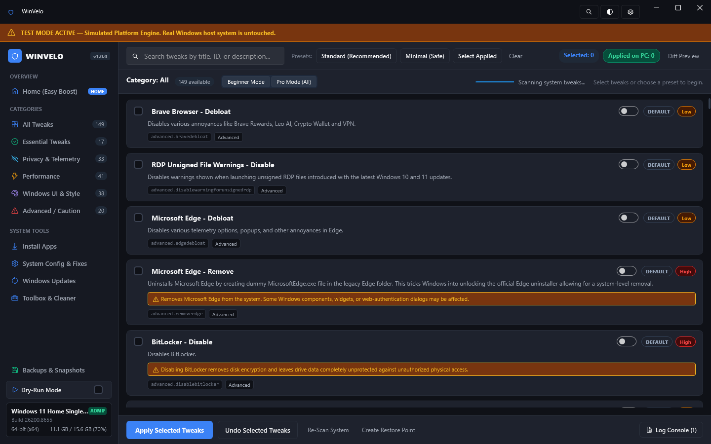
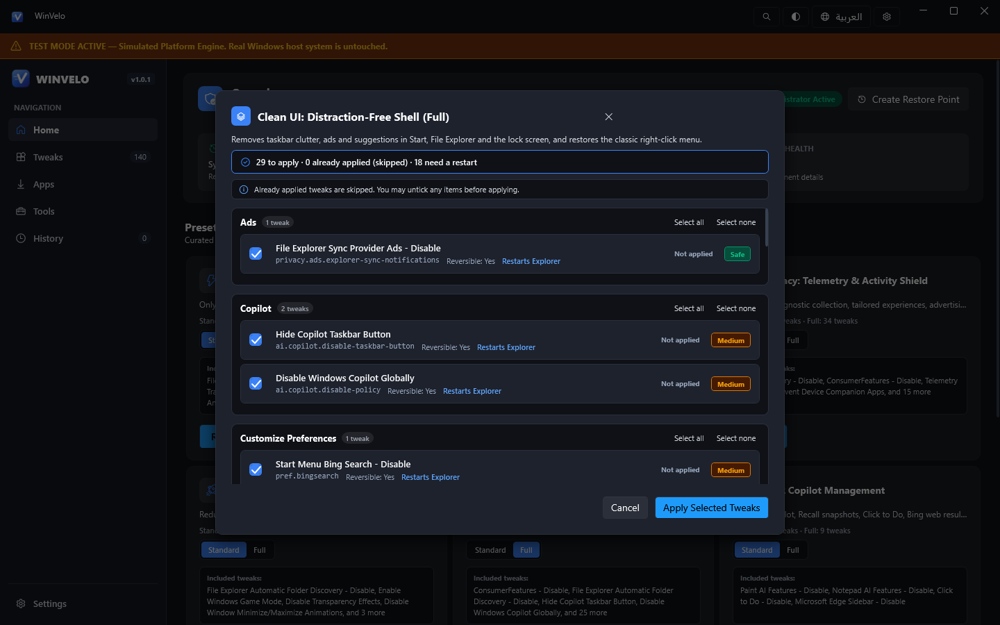
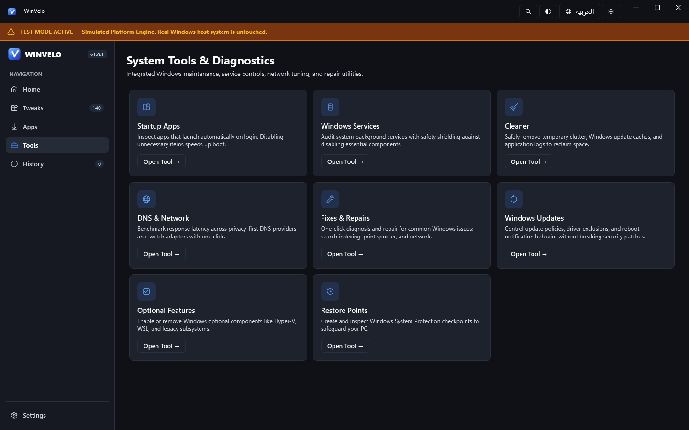
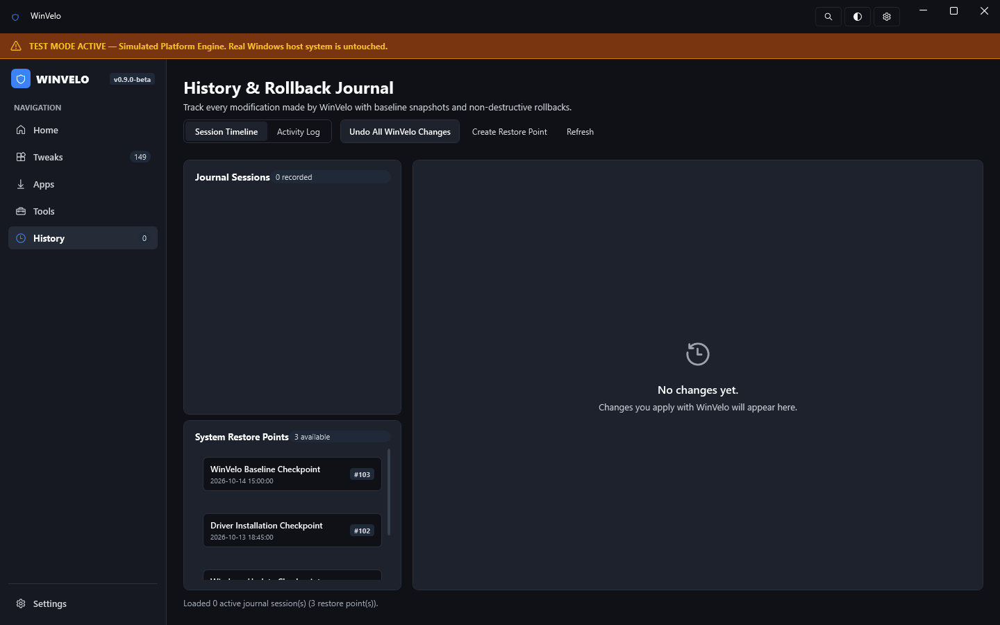
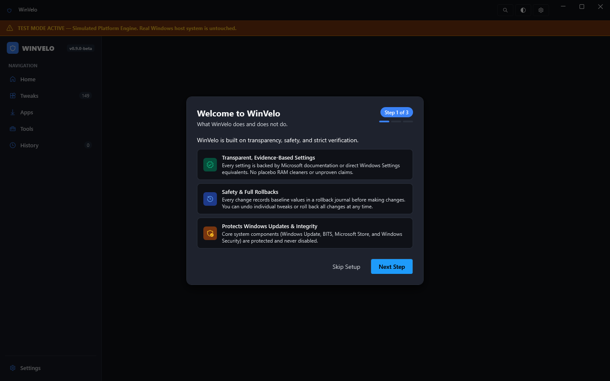
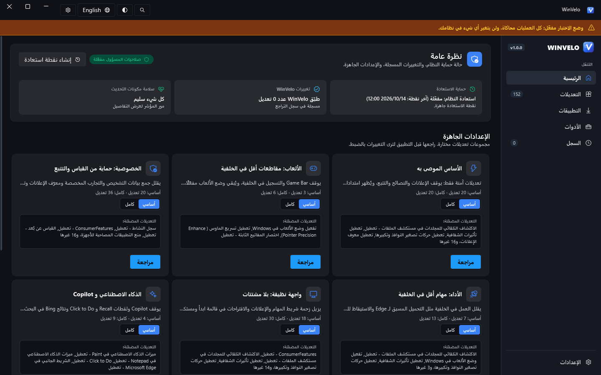

<p align="center">
  
</p>

<h1 align="center">WinVelo</h1>

<p align="center">
  <b>Tweak Windows 10 and 11 without guessing: see every change before it happens, and undo it later.</b><br/>
  Open source, no telemetry, no placebo tweaks.
</p>

<p align="center">
  <a href="https://github.com/Ziadtareks/WinVelo/actions/workflows/build-and-test.yml"></a>
  <a href="https://github.com/Ziadtareks/WinVelo/releases/latest"></a>
  
  
  <a href="LICENSE"></a>
</p>

<p align="center">
  <a href="https://github.com/Ziadtareks/WinVelo/releases/latest"><b>⬇ Download the latest release</b></a>
  &nbsp;·&nbsp; <a href="#verify-your-download">Verify your download</a>
  &nbsp;·&nbsp; <a href="#بالعربية">العربية</a>
</p>


---

## Download

1. Download **`WinVelo-v<version>-portable.zip`** from the [latest release](https://github.com/Ziadtareks/WinVelo/releases/latest).
2. Unzip it anywhere: your Desktop, a tools folder, or a USB stick.
3. Run **`WinVelo.exe`** and accept the administrator prompt.

There is nothing to install and you don't need to download .NET, because the runtime is built into the exe. The tweak catalog is built in too, so `WinVelo.exe` works on its own.

> **Advanced:** to try your own tweak definitions, make a folder with the same layout as [`Catalog`](Catalog) in this repository (for example `MyCatalog\Tweaks\extras.json`) and start `WinVelo.exe --catalog MyCatalog` (or `winvelo-cli --catalog MyCatalog ...`). Each file there replaces the built-in file with the same path. Because catalog files can run PowerShell as administrator, WinVelo asks you to confirm the folder first, and never uses a folder you did not name. A broken file or tweak is skipped and reported.

> **Windows SmartScreen:** WinVelo isn't code-signed yet, so Windows may show *"Windows protected your PC"*. Check your download first (see below), then click **More info** and **Run anyway**.

**Requirements:** Windows 10 version 2004 (build 19041) or newer, or Windows 11, 64-bit.

### Verify your download

Releases are normally built by GitHub Actions from the tagged source ([release workflow](.github/workflows/release.yml)), not on a developer PC. Exception: **v1.0.2 and v1.0.3 were built locally** because GitHub Actions is unavailable for the account, so they have no build attestation. Each release has three files:

| File | What it is |
|---|---|
| `WinVelo-v<version>-portable.zip` | The app and the CLI |
| `WinVelo-v<version>-portable.zip.sha256` | The SHA-256 hash of the zip |
| `SHA256SUMS.txt` | Hashes of the zip, `WinVelo.exe` and `winvelo-cli.exe` |

1. Download the zip and its `.sha256` file into the same folder.
2. In PowerShell, in that folder, run (replace `<version>`):

   ```powershell
   $zip      = "WinVelo-v<version>-portable.zip"
   $expected = (Get-Content "$zip.sha256" -Raw).Split(' ')[0]
   $actual   = (Get-FileHash $zip -Algorithm SHA256).Hash
   if ($actual -eq $expected) { "OK: the hash matches" } else { "STOP: the hash does NOT match" }
   ```

   `-eq` ignores upper/lower case, so it works with the lowercase hash in the file.
3. Optional, stronger check (only for releases built by GitHub Actions, when the release notes say so): the zip carries a [build provenance attestation](https://docs.github.com/actions/security-for-github-actions/using-artifact-attestations) that proves it was built by this repository's workflow. With the [GitHub CLI](https://cli.github.com/):

   ```powershell
   gh attestation verify WinVelo-v<version>-portable.zip --repo Ziadtareks/WinVelo
   ```

If a hash does not match, do not run the file. Download it again from the [releases page](https://github.com/Ziadtareks/WinVelo/releases) and [open an issue](https://github.com/Ziadtareks/WinVelo/issues) if it still fails.

### Antivirus false positives

Some antivirus products flag Windows tweak tools, including WinVelo, as "potentially unwanted" or with a generic heuristic name. This happens because a tweak tool does what malware also does: it asks for administrator rights, changes registry policies, stops services and scheduled tasks, and runs PowerShell. A new, unsigned exe that few people have downloaded yet also has no reputation, which makes a heuristic warning more likely.

What you can do:

- Check the hash (and the attestation, when the release has one) as shown above. If they match, the file is exactly what the release notes say: an official build from the public source.
- Read the source of what you are about to run. Every tweak is plain JSON in [`Catalog/Tweaks`](Catalog/Tweaks), and the app shows every registry value, service and task before it changes anything.
- Try it without touching your PC first: `WinVelo.exe --test-mode`.
- If your antivirus still flags a release whose hash matches, please report it to the antivirus vendor as a false positive and [tell us](https://github.com/Ziadtareks/WinVelo/issues).

Never turn off your antivirus to run WinVelo. Code signing is planned ([docs/RELEASING.md](docs/RELEASING.md#code-signing-off-until-a-certificate-exists)) and will reduce these warnings.

---

## What WinVelo does

- **Shows every change before it happens.** Each tweak lists the exact registry values, services or scheduled tasks it touches, its risk level, its side effects and where the information comes from.
- **Lets you undo anything reversible.** Before a change is written, the original value is saved to a rollback journal (`%APPDATA%\WinVelo`). You can undo a single tweak, a whole session, or every change WinVelo has made.
- **Is honest about evidence.** Each tweak is labelled as *documented* (Microsoft documentation, with a quote), *UI-equivalent* (the same switch exists in Windows Settings, and the path is shown), *situational* (it fixes a specific problem), or *anecdotal*. Anecdotal tweaks stay hidden under **Experimental**.
- **Keeps Windows working.** Windows Update, the Microsoft Store, BITS and Windows Security are protected and are never disabled or stopped. This is enforced in the code, so even an edited catalog cannot do it. The *Turn off automatic updates* mode only sets the `NoAutoUpdate` policy; you can still update from Settings.

### What it doesn't do

- No "FPS boost", "RAM cleaner" or other placebo tweaks.
- No telemetry, analytics, ads or update checks. WinVelo only uses the network when you install an app or run the DNS benchmark. See [PRIVACY.md](PRIVACY.md).
- Nothing is applied without you choosing it and confirming it.

---

## Features

| | |
|---|---|
| **Home** | System status: administrator rights, restore point, number of WinVelo changes and servicing health. It also holds the presets. |
| **Presets** | Recommended, Privacy, AI & Copilot, Clean UI, Performance and Gaming, each with a *Standard* and a *Full* level. A preview shows every tweak before anything is applied, plus a "Not included" list that explains what was left out and why. |
| **Tweaks** | All 140 tweaks, searchable and filterable by category, risk (Safe, Low, Medium, High) and status (Applied, Partial, Not applied, Can't verify). **Simple mode** shows only Safe and Low tweaks that have strong evidence. |
| **Apps** | Install 36 popular apps in one go with `winget` (or Chocolatey). |
| **Tools** | Startup apps, Windows services, cleaner, DNS benchmark and switcher, common fixes, Windows Update settings, optional features and restore points. |
| **History** | Every session WinVelo ran, with one-click undo. |
| **Languages** | English and Arabic, with a full right-to-left layout. You can switch in **Settings › Language**. |

<details>
<summary><b>More screenshots</b></summary>

**Tweaks**


**Preset preview**


**Tools**


**Apps**


**History**


**Settings**


**Arabic interface**


</details>

---

## بالعربية

WinVelo أداة مفتوحة المصدر لضبط Windows 10 و 11. تعرض لك كل تعديل بالتفصيل قبل تطبيقه، وتتيح لك التراجع عنه في أي وقت.

1. نزّل **`WinVelo-v<version>-portable.zip`** من [صفحة الإصدارات](https://github.com/Ziadtareks/WinVelo/releases/latest).
2. فك الضغط في أي مكان، وشغّل **`WinVelo.exe`** ووافق على طلب صلاحيات المسؤول. لا يحتاج إلى تثبيت ولا إلى تنزيل .NET، وقائمة التعديلات مدمجة في البرنامج.
3. لتحويل الواجهة إلى العربية: **Settings › Language › العربية**، ثم أعد تشغيل البرنامج.

**ما يقدّمه:** يعرض كل قيمة في السجل وكل خدمة ومهمة مجدولة قبل تغييرها، مع مستوى الخطورة والآثار الجانبية والمصدر. يحفظ القيمة الأصلية قبل كل تغيير في سجل التراجع (`%APPDATA%\WinVelo`) لتتراجع عن تعديل واحد أو جلسة أو كل شيء. لا يعطّل أبدًا Windows Update ولا BITS ولا متجر Microsoft ولا أمان Windows، وهذا مفروض في الكود نفسه. لا قياس عن بُعد ولا إعلانات ولا تعديلات وهمية من نوع «تسريع الألعاب» أو «تنظيف الذاكرة».

**تحقّق من الملف قبل تشغيله:** نزّل الملف `WinVelo-v<version>-portable.zip.sha256` بجانب الملف المضغوط، ثم شغّل في PowerShell داخل نفس المجلد:

```powershell
$zip = "WinVelo-v<version>-portable.zip"
(Get-FileHash $zip -Algorithm SHA256).Hash -eq (Get-Content "$zip.sha256" -Raw).Split(' ')[0]
```

إذا ظهرت `True` فالملف سليم ومطابق لما بناه GitHub Actions. التفاصيل في قسم [Verify your download](#verify-your-download).

**تحذير SmartScreen أو برنامج الحماية:** البرنامج غير موقّع رقميًا بعد، لذلك قد يظهر *Windows protected your PC*؛ تحقّق من الملف أولًا ثم اضغط **More info** ثم **Run anyway**. قد تصنّف بعض برامج الحماية أدوات الضبط كـ«برامج غير مرغوبة» لأنها تغيّر السجل والخدمات؛ لا تعطّل برنامج الحماية، بل تحقّق من الـ hash وأبلغ الشركة عن إنذار خاطئ.

**جرّبه بأمان:** `WinVelo.exe --test-mode` يعرض الواجهة كاملة دون أي تغيير في جهازك ودون طلب صلاحيات المسؤول. ننصح بإنشاء نقطة استعادة قبل أول تعديل، والبدء بالوضع البسيط أو بالمستوى *Standard* من الإعدادات المسبقة.

---

## Safety tips

- Create a restore point before your first changes. WinVelo offers to do this for you.
- Start with a preset's **Standard** level or with **Simple mode**.
- **High**-risk tweaks and irreversible actions (for example removing Edge or OneDrive) are never part of a preset and ask for extra confirmation.
- Some tweaks need a restart or an Explorer restart. The preview tells you which ones.
- Tweaks that only work on a certain Windows build or edition are skipped on other PCs, and the tweak card says why.
- You can try the whole interface without touching your system: `WinVelo.exe --test-mode`. Test mode does not ask for administrator rights.

---

## Command line

`winvelo-cli.exe` ships in the same zip. It runs in **simulation mode by default**. Add `--real-mode` to change the real system.

```powershell
winvelo-cli --list                                # list all tweaks
winvelo-cli --info privacy.advertising.advertising-id   # details and exact changes
winvelo-cli --detect-all                          # read-only status of every tweak
winvelo-cli --preset privacy --dry-run            # preview a preset
winvelo-cli --tweak ui.explorer.show-file-extensions --apply --real-mode
winvelo-cli --tweak ui.explorer.show-file-extensions --undo --real-mode
winvelo-cli --diagnostics WinVelo-Diagnostics.zip # anonymised bundle for bug reports
```

Run `winvelo-cli --help` for every option.

---

## Build from source

You need Windows 10/11 and the [.NET 10 SDK](https://dotnet.microsoft.com/download/dotnet/10.0).

```powershell
git clone https://github.com/Ziadtareks/WinVelo.git
cd WinVelo

dotnet build WinVelo.sln -c Release
dotnet test src/WinVelo.Tests/WinVelo.Tests.csproj
dotnet run --project tools/CatalogValidator/CatalogValidator.csproj

# run the app without touching your system
dotnet run --project src/WinVelo.App/WinVelo.App.csproj -- --test-mode

# build the portable package into dist\
.\build\publish.ps1
```

### Adding a tweak

Tweaks are plain JSON files in [`Catalog/Tweaks`](Catalog/Tweaks), checked against [`Catalog/schema/tweak.schema.json`](Catalog/schema/tweak.schema.json). See the [tweak authoring guide](docs/TWEAK_GUIDE.md), then run the catalog validator and `tools/PresetGenerator` before you open a pull request.

---

## Credits

- [WinUtil](https://github.com/ChrisTitusTech/winutil) by Chris Titus Tech (MIT). Many tweaks started from WinUtil's catalog.
- [O&O ShutUp10++](https://www.oo-software.com/en/shutup10), which inspired the calm, transparent presentation.
- [WPF UI](https://github.com/lepoco/wpfui) for the Fluent controls.
- Full list: [THIRD-PARTY-NOTICES.md](THIRD-PARTY-NOTICES.md).

## License

[MIT](LICENSE). See also [PRIVACY.md](PRIVACY.md), [SECURITY.md](SECURITY.md), [CONTRIBUTING.md](CONTRIBUTING.md) and the [CHANGELOG](CHANGELOG.md).

WinVelo changes system settings. Use it at your own risk and keep a restore point.
