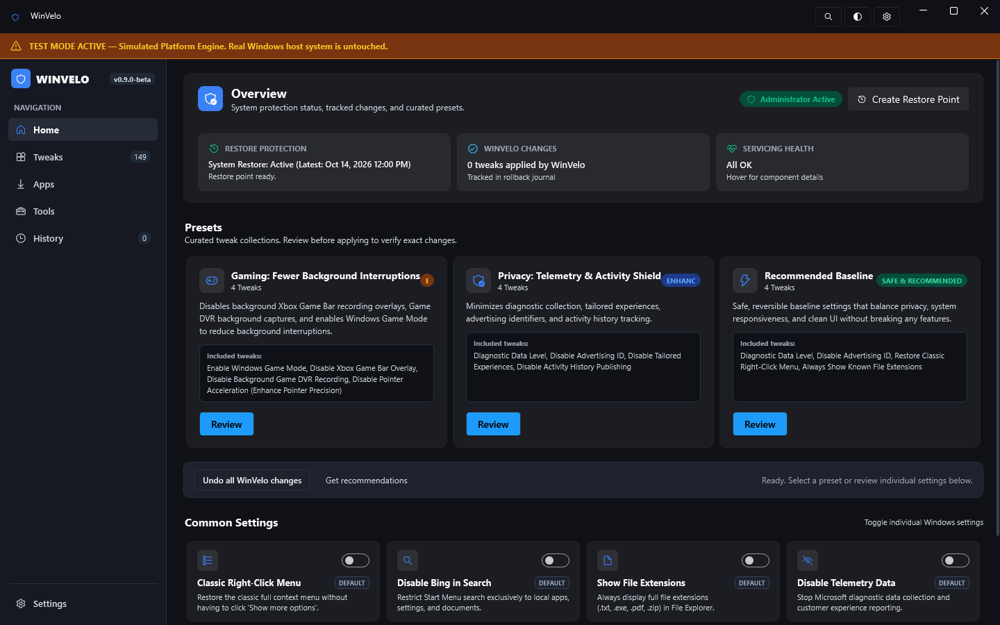
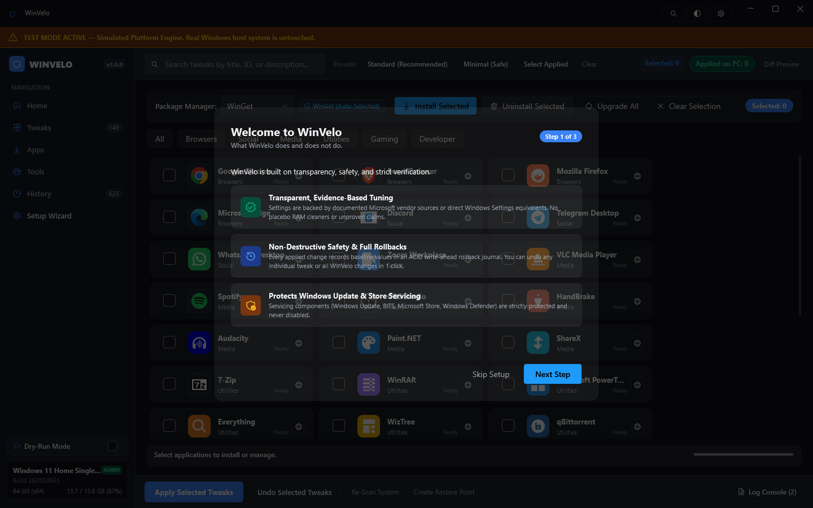

# WinVelo ⚡🛡️

[]()
[](https://dotnet.microsoft.com/)
[]()
[]()
[]()
[](LICENSE)
[](docs/SAFETY.md)

**WinVelo** (Windows Velocity) is a modern, high-performance, open-source Windows 10/11 system configuration center, debloater, and essential package manager. Built with C# and .NET 10 LTS, it pairs the full tweak catalog of Chris Titus Tech's WinUtil with a beginner-friendly 1-click optimization dashboard, write-ahead rollback safety journal, dry-run diff preview, and curated software installer.

> **Credits**: Based on tweak specifications and upstream research from [ChrisTitusTech/winutil](https://github.com/ChrisTitusTech/winutil) (MIT License).

---

## 📸 Visual Showcase

### Home (Easy Boost) Dashboard
Real-time hardware metrics (Physical RAM usage, CPU model, Windows build), 4 one-click optimization profiles, and 8 instant quick toggles.


### All Tweaks & Debloating (Beginner & Pro Modes)
141 verified system tweaks with 1-click direct toggle switches, Beginner Mode filter, multi-selection, and safety caution cards.


### Curated Essential Apps Installer (Winget)
36 everyday essential applications with official branded color tiles, live installation status, and package upgrade support.


---

## 🌟 Key Features & Tabs

### 1. 🚀 Home (Easy Boost)
- **Live System Health**: Physical RAM usage bar via Win32 `GlobalMemoryStatusEx`, CPU model detection, OS edition, Hostname, and Administrator status.
- **4 Smart 1-Click Profiles**:
  - `Everyday Speed & Clean Setup`: Recommended daily boost for general responsiveness.
  - `Gaming & Max FPS Boost`: Latency reduction, GPU priority, GameDVR disable.
  - `Privacy & Anti-Spyware Shield`: Comprehensive telemetry and activity tracking lockdown.
  - `Restore Windows Defaults`: 1-click safe rollback to factory Windows behavior.
- **8 Instant Quick Toggles**: Classic Context Menu, Disable Bing in Search, Show File Extensions, Disable Telemetry, Disable Spotlight Ads, End Task on Taskbar, Disable Background Apps, System Dark Mode.

### 2. ⚡ All Tweaks (141 Tweaks)
- **Beginner Mode vs Pro Mode**: Switch between recommended safe optimizations or access all 141 granular system tweaks.
- **Direct 1-Click Toggles**: Flip individual settings immediately or select multiple tweaks for batch application.
- **Dry-Run Diff Preview**: Inspect exact registry keys and services that will change before touching anything.
- **Safety Cards**: Amber alert badges for caution items (e.g. BitLocker, Edge removal) with explicit confirmation requirements.

### 3. 📦 Install Apps (Curated Package Manager)
- 36 popular applications curated across Browsers, Social, Media, Utilities, Gaming, and Dev (Chrome, Firefox, Brave, Discord, Spotify, VLC, Steam, VS Code, 7-Zip, Git, etc.).
- Official brand-colored icon badges with installed state detection.
- Asynchronous Winget execution with live output log and progress tracking.

### 4. 🔧 System Config & Fixes
- 14 Legacy Windows Control Panel shortcuts (Control Panel, Network Connections, Device Manager, Sound, etc.).
- Quick Fixes: Reset Windows Update, Reset Network / Winsock, DISM & SFC Scan, NTP Time Sync, Reinstall Winget, Autologin helper.
- Windows Optional Features (WSL, Hyper-V, Sandbox, .NET Framework 3.5, etc.).

### 5. 🔄 Windows Updates Manager
- **Default (Out of Box)**: Restores Microsoft standard update behavior.
- **Security Only (Recommended)**: Delays disruptive feature upgrades while applying essential security patches.
- **Disable All Updates**: Halts all update services (requires typed "I understand" confirmation).

### 6. 🧰 Toolbox & Built-in Utilities
- Safe Cache & Junk Cleaner (%TEMP%, Windows Update cache).
- Startup Programs manager, Windows Services manager, and DNS switcher (Cloudflare, Quad9, Google, AdGuard).

### 7. 🛡️ Backups & Snapshots
- Write-Ahead Rollback Journal: Automatically records original system state to `%APPDATA%\WinVelo\Journal`.
- System Restore Points: 1-click creation of official Windows System Restore points.
- Revert snapshots with a single click.

---

## 💾 Downloads (Release v1.0.0)

| Package | Type | Size | SHA256 Checksum |
|---|---|---|---|
| **[WinVelo-v1.0.0-win-x64-portable.zip](dist/WinVelo-v1.0.0-win-x64-portable.zip)** | Standalone Portable (Includes .NET Runtime) | ~95 MB | `A747C881B457C2BFBCE8F8565E147C495656940C7C6ECBF289BCFA9F1143F02D` |
| **[WinVelo-v1.0.0-win-x64-small.zip](dist/WinVelo-v1.0.0-win-x64-small.zip)** | Framework Dependent (Requires .NET 10) | ~4 MB | `6FF99DF64E5309854856F1C3CDE9E0DF0328E24668FB7FE247F4F18E2AF7A3F0` |

---

## ⌨️ Command-Line Interface (`winvelo-cli`)

WinVelo includes a dedicated headless automation CLI (`winvelo-cli.exe`):

```powershell
# Run HKCU-safe automated self-test with rollback verification
winvelo-cli.exe --self-test --level 1

# List all available tweaks
winvelo-cli.exe --list

# Apply or preview an exported configuration JSON
winvelo-cli.exe --config my-setup.json --run
winvelo-cli.exe --config my-setup.json --dry-run

# Apply a specific tweak
winvelo-cli.exe --apply "ui.explorer.classic-context-menu"

# Undo a specific tweak
winvelo-cli.exe --undo "ui.explorer.classic-context-menu"
```

---

## 🚀 Building from Source

### Prerequisites
- Windows 10 (Build 19041+) or Windows 11
- [.NET 10 SDK (LTS)](https://dotnet.microsoft.com/)

### Clone and Build
```powershell
git clone https://github.com/winvelo/winvelo.git
cd winvelo

# Build solution
dotnet build Tweakora.sln

# Run unit test suite (66 tests)
dotnet test src/Tweakora.Tests/Tweakora.Tests.csproj

# Run UI automation test suite (FlaUI)
dotnet test src/Tweakora.UiTests/Tweakora.UiTests.csproj

# Run application in safe simulated test mode
dotnet run --project src/Tweakora.App/Tweakora.App.csproj -- --test-mode
```

---

## 🏷️ Naming

WinVelo was previously developed under the project name **Tweakora**. To avoid breaking internal solution references, package configurations, and project dependencies, internal C# namespaces, project files (`.csproj`), directory names, and the solution file (`Tweakora.sln`) retain the `Tweakora.*` prefix. All user-facing executables (`WinVelo.exe`, `winvelo-cli.exe`), desktop shortcuts, installer packages, documentation, and user data directories use the **WinVelo** name.

---

## 📄 License

WinVelo is released under the **[MIT License](LICENSE)**. Feel free to use, modify, and distribute it freely.
