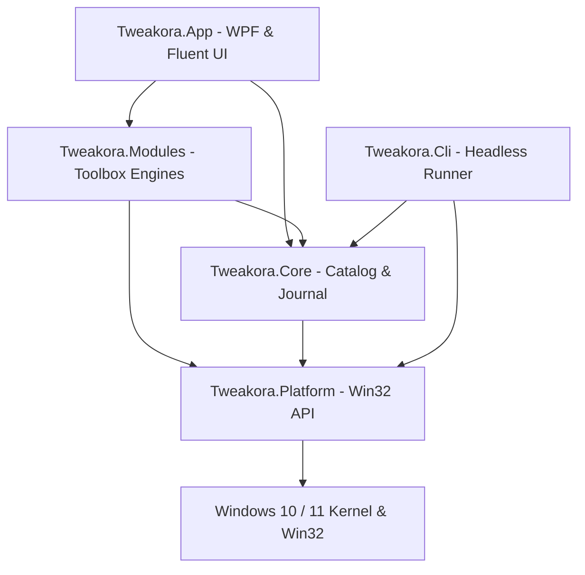

# WinVelo Architecture Specification

WinVelo is an open-source, modular, data-driven Windows 10/11 system configuration and toolbox platform. It is engineered with a strict separation between UI, business logic, platform operations, and execution environments.

---

## 1. High-Level System Layers



---

## 2. Project Responsibilities

### `Tweakora.Core` (No UI Dependencies)
- **Target Framework**: `.NET 10`
- **Models**:
  - `TweakDefinition`: Data-contract representation of a tweak complying with `tweak.schema.json`.
  - `ActionItem`: Discrete operation definitions (`Registry`, `Service`, `Task`, `File`, `OptionalFeature`).
  - `DetectRule`: State detection rules supporting `all`, `any`, and single checks.
  - `TweakoraProfile`: Multi-tweak bundles and serialization engines (JSON, `.reg`, PowerShell `.ps1`).
- **Engine Components**:
  - `TweakRunner`: Transactional executor managing dry-run preview, restore point creation, pre-execution baseline capture, write-ahead journaling, and undo actions.
  - `RollbackJournalManager`: Write-ahead logging manager saving snapshots in `%APPDATA%\Tweakora\Journal`. Always preserves initial baseline state.
  - `DryRunEngine`: Generates granular diffs between current system state and proposed actions without applying changes.
  - `StateDetector`: Evaluates whether a tweak is currently applied on the system.
- **Fakes Layer (`Tweakora.Core.Fakes`)**:
  - In-memory mock implementations for Registry, Services, Tasks, Shell, and Restore Points, enabling 100% test coverage without touching the host operating system.

### `Tweakora.Platform` (Windows Native APIs)
- **Target Framework**: `.NET 10 (Windows)`
- Implements real Win32 interfaces:
  - `RegistryService`: Access to `HKEY_CURRENT_USER`, `HKEY_LOCAL_MACHINE`, `HKEY_CLASSES_ROOT`.
  - `ServiceManagerService`: Native `Advapi32.dll` calls (`OpenSCManager`, `OpenService`, `ChangeServiceConfig`).
  - `TaskSchedulerService`: COM interface `ITaskService` (`TaskScheduler.dll`) to query and toggle scheduled tasks.
  - `SystemRestoreService`: Win32 `sfc.dll` / `srclient.dll` calling `SRSetRestorePointW`.

### `Tweakora.Modules` (Domain Toolboxes)
- `Tweakora.Modules.Dashboard`: Hardware and OS telemetry (`SystemInfoProvider`).
- `Tweakora.Modules.Startup`: Startup application scanner and registry toggle (`StartupManager`).
- `Tweakora.Modules.Services`: Service enumeration and management (`ServicesManager`).
- `Tweakora.Modules.Cleaner`: Whitelisted temporary file previewer and cleaner (`SmartCleaner`).
- `Tweakora.Modules.Apps`: Curated software catalog and WinGet package manager integration (`WinGetManager`).
- `Tweakora.Modules.Uninstaller`: Installed application scanner and uninstaller launcher (`AppUninstaller`).
- `Tweakora.Modules.Fixes`: System recovery recipes for Windows Update, DNS, Winsock, Print Spooler, and Icon Cache (`FixesCenter`).
- `Tweakora.Modules.Network`: Fast DNS switcher with live latency ping testing (`DnsSwitcher`).

### `Tweakora.App` (Presentation Layer)
- **UI Framework**: WPF with `WPF UI` (`lepoco/wpfui` 4.0.3).
- **Themes & Materials**: Mica backdrop on Windows 11 with seamless solid background fallback on Windows 10. Automatic Light and Dark theme adaptation.
- **Localization**: Runtime dynamic localization between English and Arabic (`LocalizationManager`). Automatic layout mirroring to Right-to-Left (RTL) for Arabic.
- **Keyboard Navigation**: Command Palette modal accessible via `Ctrl+K`.
- **Diagnostics**: Structured file logging using `Serilog`.

### `Tweakora.Cli` (Headless Automation)
- Command-line executable for unattended configuration and deployment scripts:
  ```powershell
  tweakora.exe --list
  tweakora.exe --apply "ui.explorer.classic-context-menu"
  tweakora.exe --preset "preset.recommended" --dry-run
  tweakora.exe --undo "ui.explorer.classic-context-menu"
  ```

---

## 3. Directory Layout

```text
C:\Dev\Tweakora\
├── Catalog\                     # Strict JSON definitions
│   ├── Apps\                    # Curated WinGet store catalog
│   ├── Fixes\                   # Windows troubleshooting recipes
│   ├── Presets\                 # Curated system profiles
│   ├── schema\                  # tweak.schema.json & negative tests
│   └── Tweaks\                  # 84 verified tweak definitions
├── dist\                        # Release artifacts (Single-file exe & setup)
├── docs\                        # Architecture, Safety, and Guides
├── installer\                   # Inno Setup compilation script
├── src\
│   ├── Tweakora.App\            # WPF Views, ViewModels, Resources
│   ├── Tweakora.Cli\            # Headless command-line tool
│   ├── Tweakora.Core\           # Engine, models, fakes, profiles
│   ├── Tweakora.Modules\        # Domain toolbox implementations
│   ├── Tweakora.Platform\       # Windows native API bindings
│   └── Tweakora.Tests\          # xUnit unit test suite
└── tools\
    └── CatalogValidator\        # Schema verification utility
```
