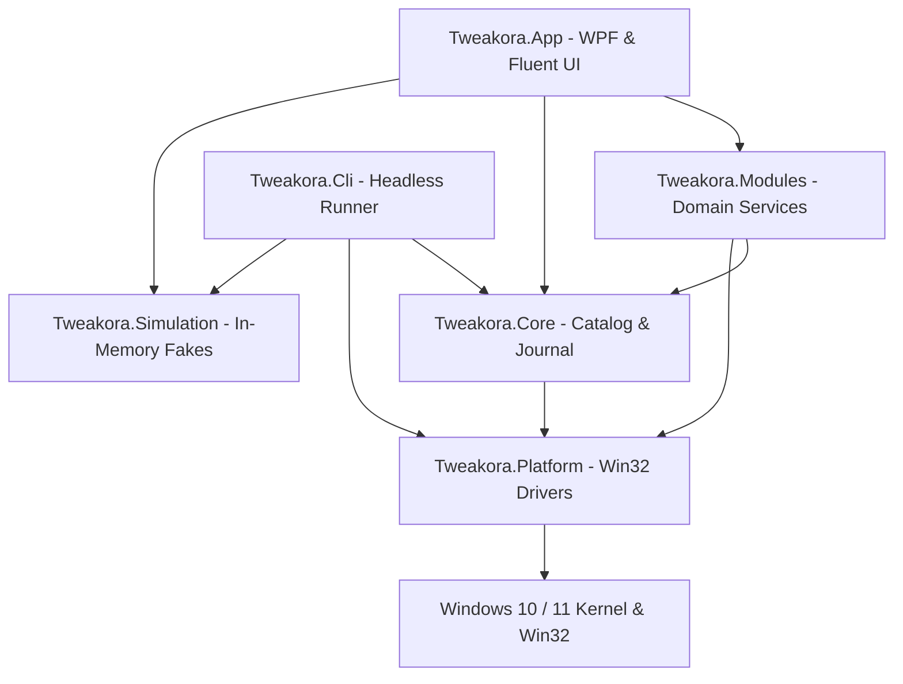

# WinVelo Architecture Specification

WinVelo is an open-source, modular, data-driven Windows 10/11 system configuration and toolbox platform. It is engineered with a strict separation between UI, business logic, platform operations, and execution environments.

---

## 1. High-Level System Layers



---

## 2. Project Responsibilities

### `Tweakora.Core` (No UI Dependencies)
- **Target Framework**: `.NET 10`
- **Models**:
  - `TweakDefinition`: Data-contract representation of a tweak complying with `tweak.schema.json`.
  - `ActionItem`: Discrete operation definitions (`Registry`, `Service`, `Task`, `File`, `OptionalFeature`).
  - `DetectRule`: State detection rules supporting `all`, `any`, and single checks.
  - `TweakoraProfile`: Multi-tweak bundles and serialization engines (JSON, `.reg`, PowerShell `.ps1`).
- **Engine Components**:
  - `RollbackJournalManager`: Write-ahead logging manager saving snapshots in `%APPDATA%\WinVelo\Journal`. Always preserves initial baseline state.
  - `OperationRunner`: Universal task executor coordinating operations, journal records, and live UI activity tracking.
  - `StateDetector`: Evaluates whether a tweak is currently applied on the system.
  - `RegistryActionHandler`, `ServicesActionHandler`, `TasksActionHandler`: Modular handlers executing discrete system actions.

### `Tweakora.Simulation` (In-Memory Mock Layer)
- **Target Framework**: `.NET 10`
- Isolated test drivers implementing platform interfaces for headless unit tests and FlaUI test runs:
  - `FakeRegistryService`: In-memory simulated registry supporting HKCU, HKLM, and HKCR hives.
  - `FakeServicesService`: In-memory service state tracker with configurable initial states.
  - `FakeTaskSchedulerService`: In-memory scheduled task status manager.
  - `FakeRestoreService`: Simulated restore point creator with validation tracking.
  - `FakeShellService`: Safe process and command simulator preventing actual script execution.

### `Tweakora.Platform` (Windows Native APIs)
- **Target Framework**: `.NET 10 (Windows)`
- Implements real Win32 interfaces:
  - `WindowsRegistryService`: Direct Windows Registry manipulation across `HKCU`, `HKLM`, and `HKCR`.
  - `WindowsServicesService`: Native `Advapi32.dll` calls (`OpenSCManager`, `OpenService`, `ChangeServiceConfig`).
  - `WindowsTaskSchedulerService`: Native Windows Task Scheduler integration.
  - `WindowsRestoreService`: Win32 `sfc.dll` / `srclient.dll` calling `SRSetRestorePointW`.
  - `WindowsShellService`: Native process launcher and elevated execution engine.
  - `WindowsSettingNotifier`: Win32 `SendMessageTimeout` (`WM_SETTINGCHANGE`) and `SHChangeNotify` change broadcasting.

### `Tweakora.Modules` (Domain Services)
- `Tweakora.Modules.Advisor`: Hardware profile inspection and optimization recommendations (`SmartAdvisorService`).
- `Tweakora.Modules.Apps`: Curated software catalog and package manager integration (`AppInstallService`).
- `Tweakora.Modules.Cleaner`: Whitelisted temporary file previewer and cleaner (`CleanerService`).
- `Tweakora.Modules.Config`: Feature toggling via DISM (`FeatureService`) and system repair recipes (`FixService`).
- `Tweakora.Modules.Memory`: Standby list memory cleaner and cache purge (`MemoryOptimizerService`).
- `Tweakora.Modules.Network`: Fast DNS switcher with latency testing (`DnsService`) and TCP/Nagle optimizer (`NetworkOptimizerService`).
- `Tweakora.Modules.Services`: Windows background service management (`ServicesManagerService`).
- `Tweakora.Modules.Startup`: Task Manager `StartupApproved` sync and boot speed optimizer (`StartupService`).
- `Tweakora.Modules.Tweaks`: Catalog loader, detector, and execution orchestrator (`TweakService`).
- `Tweakora.Modules.Updates`: Windows Update mode switcher (`UpdateModeService`).

### `Tweakora.App` (Presentation Layer)
- **UI Framework**: WPF with `WPF-UI` (`lepoco/wpfui` 4.0.3).
- **Themes & Materials**: Mica backdrop on Windows 11 with seamless solid background fallback on Windows 10. Automatic Light and Dark theme adaptation.
- **Localization**: English-only user interface (`LocalizationManager`).
- **Keyboard Navigation**: Command Palette modal accessible via `Ctrl+K`.
- **Diagnostics**: Structured file logging using `Serilog` (`LoggingService`), rolling daily logs to `%LOCALAPPDATA%\WinVelo\Logs`.

### `Tweakora.Cli` (Headless Automation)
- Command-line executable (`winvelo-cli.exe`) for unattended configuration and deployment scripts:
  ```powershell
  # List all catalog tweaks
  winvelo-cli.exe --list

  # Preview standard preset in dry-run mode
  winvelo-cli.exe --preset Standard --dry-run

  # Apply a specific tweak against host OS
  winvelo-cli.exe --tweak "ui.explorer.classic-context-menu" --apply --real-mode

  # Revert a specific tweak
  winvelo-cli.exe --tweak "ui.explorer.classic-context-menu" --undo --real-mode

  # Automated non-destructive HKCU roundtrip self-test
  winvelo-cli.exe --self-test --level 1
  ```

---

## 3. Directory Layout

```text
C:\Dev\Tweakora\
├── Catalog\                     # Strict JSON definitions
│   ├── Apps\                    # Curated applications catalog
│   ├── Config\                  # Features, appx, and DNS presets
│   ├── Presets\                 # Curated system profiles
│   ├── schema\                  # tweak.schema.json validation schema
│   ├── Tweaks\                  # 152 tweak definitions
│   ├── Localization\            # Arabic display text for tweaks and presets (ar.json)
│   └── overrides.json           # Safety overrides & baseline exclusions
├── dist\                        # Build output of build\publish.ps1 / release.ps1 (not committed)
├── docs\                        # Architecture, Safety, Roadmap, and Guides
├── src\
│   ├── Tweakora.App\            # WPF Views, ViewModels, Resources (WinVelo.exe)
│   ├── Tweakora.Cli\            # Headless command-line tool (winvelo-cli.exe)
│   ├── Tweakora.Core\           # Engine, models, journal, activity tracking
│   ├── Tweakora.Modules\        # Domain feature implementations (Tweaks, Apps, Startup, etc.)
│   ├── Tweakora.Platform\       # Windows native Win32 drivers
│   ├── Tweakora.Simulation\     # In-memory mock drivers for testing
│   ├── Tweakora.Tests\          # xUnit unit & integration test suite (135 tests)
│   └── Tweakora.UiTests\        # FlaUI UI automation test suite
└── tools\
    ├── CatalogValidator\        # Schema verification utility
    ├── SourceChecker\           # Live HTTP source documentation link checker
    └── UpstreamImporter\        # Upstream WinUtil catalog synchronization tool
```
