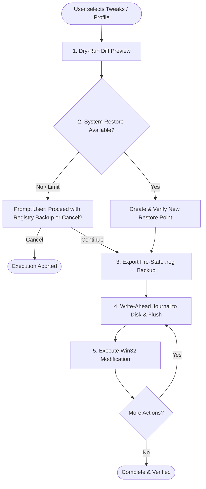

# WinVelo Safety System

System safety, predictability, and reversibility are the non-negotiable core principles of WinVelo. Every feature is engineered so that modifications can be previewed before application, recorded reliably during execution, and restored cleanly at any point.

---

## 1. Safety Pillars

---

## 2. Safety Architecture Details

### 1. Verification of System Restore Points
- Windows restricts restore point creation if one has been created within the past 24 hours (or if System Protection is disabled on the system drive).
- WinVelo queries existing restore points before initiating creation.
- After calling the Win32 `SRSetRestorePointW` API, WinVelo re-queries the system to verify that a **new** restore point was actually created.
- If creation failed or was skipped by Windows, WinVelo displays a confirmation dialog asking the user whether to proceed using the `.reg` backup only or cancel. It never continues silently.

### 2. Write-Ahead Rollback Journal (WAL)
- All actions are logged to disk under `%APPDATA%\WinVelo\Journal\session-[timestamp].json`.
- **Pre-execution flush**: The journal entry (including the true original system state) is written and flushed to disk *before* any registry key or service state is modified.
- **Baseline Preservation**: If a tweak is toggled or applied multiple times, WinVelo maintains the **original baseline value** from before the first application. The initial value is never overwritten by a modified value.
- **Non-existent keys**: If a registry value or key did not exist before the tweak was applied, `existedBefore: false` is recorded. Rollback performs a deletion rather than leaving arbitrary data behind.

### 3. Registry Backup Files (`.reg`)
- For every registry modification, WinVelo generates an independent `.reg` file containing the previous state.
- Even if WinVelo is uninstalled or unable to run, the user can double-click the exported `.reg` file to restore settings using the standard Windows Registry Editor.

### 4. Smart Cleaner Whitelist Safety
- The Smart Cleaner module strictly enforces a non-destructive directory whitelist:
  - `%TEMP%` (Current User Temp)
  - `%SYSTEMROOT%\Temp` (Windows System Temp)
  - `%SYSTEMROOT%\Prefetch` (Prefetch cache)
  - `%LOCALAPPDATA%\CrashDumps` (Application crash dumps)
- It provides size previews before any file deletion occurs.
- System files, user documents, browser histories, and arbitrary directories are physically impossible to select or delete.

### 5. Crash and Unfinished Session Recovery
- On application launch, WinVelo inspects the journal storage folder.
- If an incomplete session marker is found (indicating an unexpected power loss or process termination during modification), WinVelo prompts the user immediately with an automatic rollback option.

---

## 3. Host Development & Testing Protocol

To protect the host development workstation:
1. **Host PC Protection**:
   - During local development, all engine tests and UI demo modes use in-memory mock services (`WinVelo.Simulation`).
   - The host PC's registry, services, and filesystem are never modified by the test suite or dev runs.
2. **Virtual Machine Testing**:
   - Verification of real Windows changes takes place in dedicated Hyper-V, VMware, or VirtualBox virtual machines.
   - Always take a VM snapshot before running live test scripts.
